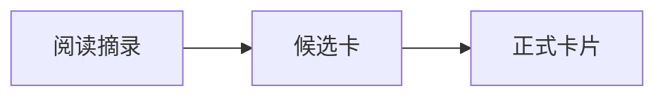

# 接页 · 知识卡片工作台 v0.2

适用于个人本地使用。功能分版和实现见 [PLAN.md](PLAN.md)。

## 启动

需要 Python 3.10 或更新版本。在本目录执行：

```sh
python3 -m venv .venv
source .venv/bin/activate
python -m pip install -r requirements.txt
python -m uvicorn app:app --host 127.0.0.1 --port 18765
```

打开 http://127.0.0.1:18765 。默认数据库为本目录的 `cards.sqlite3`，可通过 `CARDDESK_DB` 指定路径。页面也提供 Markdown 导出。界面和 API 供本机单人使用。

## 体验对话制卡

1. 在「卡库」新建一张观点卡，例如「闭卷复述可以发现理解缺口」。
2. 点「围绕这张卡提问」，输入一个值得追问的问题。
3. 在回复里选一段文字，点「从选中片段制卡」。也可以直接用整条回复制卡。
4. 核对来源，修改草稿，再点「采纳为卡片」。
5. 在右侧编辑并确认关联。点图谱中的邻居切换卡片，点连线或关系列表看说明。
6. 可以从新卡回到对话原消息，也可以在「素材」粘贴摘录，走同一个制卡流程。

## 接入真实模型

默认进入演示模式，回复和草稿来自内置模板。打开右上角「模型设置」，启用模型，填写接口根地址、模型 ID 和服务商密钥。可先「测试连接」，再「保存设置」。接口地址不变时，密钥留空会保留原值。关闭「启用模型」并保存可切回演示模式。

页面保存的配置立即生效，优先于环境变量，默认存放在数据库旁的 `cards.ai.json`。可通过 `CARDDESK_AI_CONFIG` 指定路径。密钥以明文保存在仅当前用户可读写的本地文件里，别把该文件加入共享备份。配置文件尚未创建时，也可以通过启动环境配置模型：

```sh
export AI_BASE_URL="https://api.openai.com/v1"
export AI_MODEL="<服务商提供的模型 ID>"
export AI_API_KEY="<服务商提供的密钥>"
python -m uvicorn app:app --host 127.0.0.1 --port 18765
```

接口需支持 Chat Completions 流式响应。密钥由 Python 进程读取。发送对话时，服务会把问题、近期消息和本轮所选卡片内容交给模型。制卡时发送所选片段、对应提问和关联候选卡。

## 多格式卡片

打开已保存的卡片会进入阅读视图。编辑卡片或审核候选卡时，可以点「预览正文」查看排版。

- Markdown 支持标题、列表、引用、代码块、表格和可点击链接。
- 用 `` 显示网络图片。当前使用图片链接。
- 网页可用 Markdown 链接引用。由网页摘录生成的卡片会在来源区域显示网页标题、链接和所选摘录。
- 使用标记为 `mermaid` 的代码块显示流程图。浏览器需要能访问 jsDelivr 加载 Mermaid，源码可随时展开。

````markdown
### 阅读笔记
[打开原文](https://example.com)


````


## v0.2 使用说明

- 素材页可选本地 Markdown 文件，或提取公开 HTML 网页的正文，核对后保存。网页提取支持直接返回正文的地址，登录页、浏览器动态生成的正文及重定向需要手动粘贴。
- 在卡片详情管理标签、归档状态及 AI 检索权限。合并将正文和关系转入保留的卡片，原卡仍可从合并记录中追溯来源。
- 「从卡库找参考卡」和「推荐阅读路径」会在本地按关键词匹配。配置模型后，最多将 60 张允许检索的候选卡摘要交给模型排序，候选包含关键词命中的卡片和近期卡片。无模型或调用失败时使用关键词结果。
- 在「主题」编辑阅读顺序并生成带卡片编号的提纲。模型可为允许 AI 检索的卡片补充小节要点。
- 全局图谱按标签和关系筛选，并按实际连线划分群组。单卡右侧可展开两层邻居。
- 「备份恢复」导出独立 JSON 备份。恢复会在校验通过后替换卡库。模型配置单独保存。当前恢复支持最多 25 MB 的 v0.2 JSON 备份。

升级时在原虚拟环境重新运行 `python -m pip install -r requirements.txt` 并重启服务。SQLite 表结构会在启动时升级。

## 正文引用与阅读路径

在卡片正文输入 `[[` 后可以搜索并选择目标卡片。编辑器会插入类似 `[[#12|少量稳定、可组合的工具]]` 的引用，目标卡改标题后仍能打开。也可以手写 `[[卡片标题]]`，标题需要唯一。用 `**[[卡片标题]]**` 可加粗。

在阅读视图点击引用，目标卡会展开在当前卡片下方，并滚动到屏幕中部。同一卡片展开的多个引用在空间足够时并排显示。遇到指向上级卡片的引用时，页面会滚回上级。正文引用也会出现在关系图中。

展开引用后，在卡片右上角「⋯」菜单里点「保存为主题」。在主题里展开「按保存的层级阅读」即可回看。来源、关系图谱和卡片设置也可从「⋯」菜单打开。

## GitHub Pages 只读演示

用项目虚拟环境运行 `.venv/bin/python scripts/build_demo.py`，生成 `dist/demo/`。
用 `.venv/bin/python -m http.server 18766 --directory dist` 预览，打开
[本地演示](http://127.0.0.1:18766/demo/)。预览路径带子目录，可验证 GitHub Pages 项目站点的相对资源路径。

发布时，把 `dist/demo/` 的内容（含 `.nojekyll`）放进目标仓库发布分支的根目录，
在 **Settings → Pages** 选择该分支的 **/ (root)**。每次更新公开卡库时重新构建并替换发布目录。

快照包含当前卡片正文、引用关系、已保存主题和 Markdown 导出。站点访客可以下载这些内容，
发布前请审阅 `dist/demo/cards.md` 和 `dist/demo/snapshot.json`。
